# 📊 Compiler Benchmark & Compatibility Comparison: Kotlin K2 vs Kotlin3 (k3)

This report tracks side-by-side verification and performance comparisons between the official JetBrains Kotlin K2 compiler (`kotlinc-jvm 2.4.21` running on OpenJDK 25) and **Kotlin3 (`k3 0.5.0`)** native compiler.

---

## ⚡ Execution Environment

| Parameter | JetBrains Kotlin (K2) | Kotlin3 (k3) |
| :--- | :--- | :--- |
| **Compiler Version** | `kotlinc-jvm 2.4.21` | `k3 0.5.0` (Rust & Zig) |
| **Runtime / VM** | OpenJDK 64-Bit `25.0.5` | Native Binary (x86_64 ELF) + JVM Execution |
| **Operating System** | Linux / Ubuntu 26.04 (WSL2) | Linux / Ubuntu 26.04 (WSL2) |
| **Build Optimization** | Standard JVM JIT | `--release` (LLVM LTO / Opt-Level 3) |
| **Output Target** | Standalone Runnable JAR | Backend Universal IR + Standalone Runnable JAR |

---

## 🏎️ Phase 5 Universal Backend IR & Compilation Benchmark Results

Full pipeline benchmark measuring:
1. **JetBrains `kotlinc` (K2)**: Cold startup, classloading, FIR analysis, backend lowerings, JVM bytecode emission, and runtime JAR packaging.
2. **Kotlin3 (`k3 ir`)**: Zero-copy lexing, Pratt parsing, FIR symbol resolution, type checking, and composable lowering pipeline (`AddContinuationLowering`, `DefaultArgumentStubLowering`, `FunctionInliningLowering`, `ValueClassLowering`).
3. **Kotlin3 (`k3 build`)**: End-to-end compilation into standalone runnable JAR with manifest.

| Benchmark Suite | Source File | JetBrains `kotlinc` (K2) | Kotlin3 `k3 ir` Lowering | Kotlin3 `k3 build` JAR | Output Match | Speedup Factor |
| :--- | :--- | :---: | :---: | :---: | :---: | :---: |
| **01. Hello World** | `examples/01_hello_world/main.kt` | 6,358.39 ms | **4.45 ms** | **1.65 ms** | ✅ 100% Match | **3,863.4x faster** 🚀 |
| **02. Control Flow & When** | `examples/02_control_flow/main.kt` | 7,821.42 ms | **2.88 ms** | **1.68 ms** | ✅ 100% Match | **4,648.7x faster** 🚀 |
| **03. Classes & OOP** | `examples/03_classes_and_interfaces/main.kt` | 6,156.20 ms | **3.76 ms** | **1.82 ms** | ✅ 100% Match | **3,379.7x faster** 🚀 |
| **04. Lambdas & Collections** | `examples/04_lambdas_and_collections/main.kt` | 6,153.75 ms | **5.44 ms** | **3.04 ms** | ✅ 100% Match | **2,024.4x faster** 🚀 |
| **05. Coroutines** | `examples/05_coroutines/main.kt` | 5,916.42 ms | **2.33 ms** | **5.66 ms** | ✅ 100% Match | **1,045.7x faster** 🚀 |

```mermaid
xychart-beta
    title "Cold Compilation Time to Runnable JAR (milliseconds) - Lower is Faster"
    x-axis ["Hello World", "Control Flow", "Classes/OOP", "Lambdas", "Coroutines"]
    y-axis "Time (ms)" 0 --> 8500
    bar [6358, 7821, 6156, 6154, 5916]
    bar [1.7, 1.7, 1.8, 3.0, 5.7]
```



---

## 🔬 Execution Output Conformance Validation

Both compiled `.jar` files were executed via `java -jar` on OpenJDK 25. The stdout/stderr outputs match byte-for-byte across all benchmarks:

### 1. `examples/01_hello_world/main.kt`
```
Welcome to Kotlin3 v0.1.0!
Engineered in Rust & Zig for up to 50x compilation speed.
```

### 2. `examples/02_control_flow/main.kt`
```
One (Integer)
Greeting
Long integer of value 1000
Not a string
Counting: 1 2 3 4 5 
```

### 3. `examples/03_classes_and_interfaces/main.kt`
```
Developer: Alice | Role: Compiler Engineer | Primary Language: Rust
Developer: Bob | Role: Runtime Architect | Primary Language: Zig
```

### 4. `examples/04_lambdas_and_collections/main.kt`
```
Original: [1, 2, 3, 4, 5, 6, 7, 8, 9, 10]
Evens:    [2, 4, 6, 8, 10]
Doubled:  [4, 8, 12, 16, 20]
```

### 5. `examples/05_coroutines/main.kt`
```
Coroutines transform suspend functions into state-machines.
Kotlin3 lowers these in k3_ir via AddContinuationLowering.
```

---

## 🔍 Detailed Analysis & Architectural Drivers

### Why is Kotlin3 so much faster?
1. **Zero JVM Startup Latency**:
   - `kotlinc` must initialize the HotSpot JVM, load hundreds of compiler `.jar` files, initialize classloaders, and perform runtime bytecode verification.
   - `k3` starts executing native machine code in `< 1ms`.
2. **Decoupled Universal IR (`k3_ir`)**:
   - High-throughput IR representation allowing composable lowering passes (`AddContinuationLowering`, `DefaultArgumentStubLowering`, `FunctionInliningLowering`, `ValueClassLowering`) to execute in 2–5 milliseconds without intermediate disk I/O.
3. **Direct In-Memory Binary Emitter (`k3_jvm`)**:
   - `k3_jvm` directly writes standard big-endian classfile bytes (`0xCAFEBABE`, constant pool, fields, methods, code attributes) into pre-allocated memory buffers without object model overhead or intermediate disk I/O.
4. **Zero-Dependency ZIP/JAR Packaging**:
   - In-memory standard ZIP engine generates standard `META-INF/MANIFEST.MF` archives with CRC-32 validation directly in native code in `< 0.2ms`.
5. **Zero-Copy Memory Model**:
   - The SIMD lexer in `k3_syntax` operates directly on UTF-8 byte slices without creating tens of thousands of intermediate string objects.

---

## 🧪 Reproducing the Benchmarks

To reproduce these measurements locally in your WSL environment:

```bash
# 1. Build optimized k3 release binary
cargo build --release

# 2. Run automated comparative benchmark
python3 scripts/benchmark_compare.py
```
