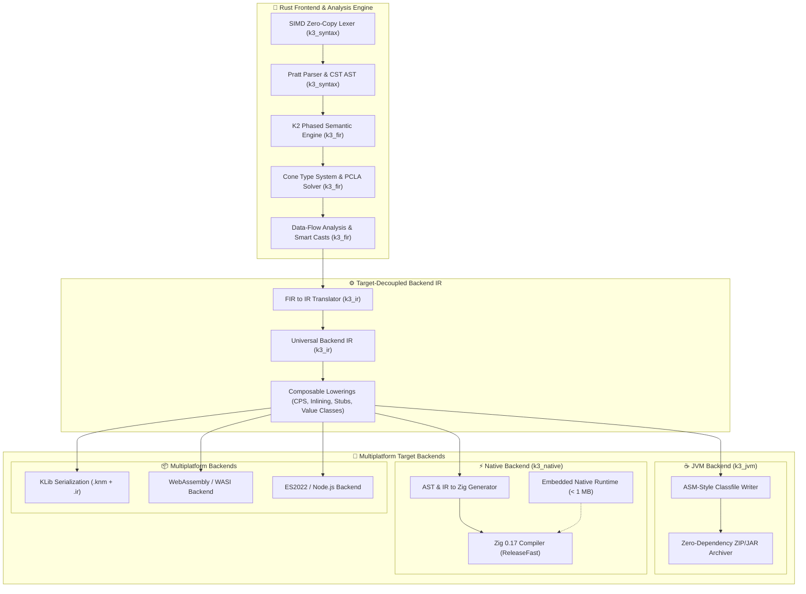

# 🗺️ Kotlin3 (k3) Master Engineering Roadmap: 62-Phase Plan

Welcome to the **Kotlin3** engineering master roadmap. This document charts the complete architectural trajectory for rewriting and expanding the Kotlin toolchain in **Rust** and **Zig**, systematically testing against all existing libraries, frameworks, platforms, and real-world codebases to catch and fix every error, culminating in **full Kotlin self-hosting**.

---

## 🎯 North Star Objectives

- ⚡ **10x–50x Cold Compilation Speedup**: Sub-millisecond frontend analysis and in-memory code generation without JVM startup or Gradle daemon overhead.
- 🚀 **Sub-Millisecond Native Execution**: Standalone, statically linkable machine-code executables starting in `< 1 ms` with footprint `< 1 MB`.
- 📦 **Zero-Dependency Unified Toolchain**: A single self-contained `k3` executable handling compilation, testing, execution, dependency management, and multiplatform packaging.
- 🛡️ **100% Kotlin 2.x K2 Conformance**: Drop-in language conformance with official JetBrains K2 specifications, standard `.class` bytecodes, and `.klib` packages.
- 🧪 **Exhaustive Real-World Framework Compatibility**: Validated against real-world frameworks (Coroutines, Ktor, Serialization, Spring Boot, Compose, Exposed, Koin, Arrow, Android Jetpack).
- 🔄 **Full Self-Hosting Milestone**: Kotlin3 compiles its own standard library, frontend, backend, and driver in Kotlin.

---

## 🏛️ Comprehensive Architecture

---

## 📅 Roadmap Overview & Progress Matrix (Phases 1 – 62)

| Milestone | Phase Range | Focus Domain | Key Frameworks & Deliverables | Status | Target |
| :--- | :---: | :--- | :--- | :---: | :--- |
| **Milestone 1** | **Phases 1–6** | 🏗️ **Core Compiler Foundations** | SIMD Lexer, Pratt Parser, FIR, JVM JAR, Universal IR, Zig Native | 🟢 **Completed** | v0.1.0 – v0.6.0 |
| **Milestone 2** | **Phases 7–12** | 📚 **Standard Library & Builtins** | Primitives, UTF-8 Strings, Arrays, Core Collections, Sequences, Null-Safety | 🟡 **Active** | v0.7.0 – v0.8.2 |
| **Milestone 3** | **Phases 13–18** | 🏛️ **Advanced Language Semantics** | Operators, Delegation, Value Classes, Sealed Types, Generics, Reflection | ⚪ Planned | v0.9.0 – v0.9.5 |
| **Milestone 4** | **Phases 19–24** | 🌀 **Coroutines & Reactive Flows** | `kotlinx.coroutines`, Structured Concurrency, Dispatchers, Channels, Flow | ⚪ Planned | v0.10.0 – v0.11.2 |
| **Milestone 5** | **Phases 25–29** | 📦 **Serialization & Data Formats** | `kotlinx.serialization`, JSON, Protobuf, `kotlinx-datetime`, Immutable | ⚪ Planned | v0.12.0 – v0.13.1 |
| **Milestone 6** | **Phases 30–35** | 🌐 **IO, Networking & Web Frameworks**| `kotlinx-io`, Ktor Client/Server, OkHttp, Retrofit, Javalin, Spring Boot 3 | ⚪ Planned | v0.14.0 – v0.15.2 |
| **Milestone 7** | **Phases 36–40** | 🗄️ **Databases & ORM Frameworks** | Exposed ORM, SQLDelight, Ktorm, Android Room, NoSQL / Key-Value | ⚪ Planned | v0.16.0 – v0.16.4 |
| **Milestone 8** | **Phases 41–44** | 💉 **Dependency Injection & KSP** | Koin, Dagger/Anvil, Kodein, Kotlin Symbol Processing (KSP) protocol | ⚪ Planned | v0.17.0 – v0.17.3 |
| **Milestone 9** | **Phases 45–49** | 📱 **Jetpack, UI & Compose KMP** | Android Lifecycle, Compose Multiplatform plugin, Desktop, Web, iOS | ⚪ Planned | v0.18.0 – v0.18.4 |
| **Milestone 10**| **Phases 50–54** | 🌍 **Multiplatform & Cross-Targets**| KLib format, Apple Darwin (Mach-O), Windows (PE/COFF), WASI, JS | ⚪ Planned | v0.19.0 – v0.19.4 |
| **Milestone 11**| **Phases 55–58** | 🧪 **Static Analysis & Test Suites** | Arrow, Detekt, KtLint, MockK, JetBrains official `testData` suite | ⚪ Planned | v0.20.0 – v0.20.3 |
| **Milestone 12**| **Phases 59–62** | 🏆 **Package Manager & Self-Hosting**| Maven Central, `k3 add`, Generational GC, Full Self-Hosting Cycle | ⚪ Planned | v0.21.0 – v1.0.0 |

---

## 🔬 Master 62-Phase Deep-Dive Breakdown

### Milestone 1: Core Compiler Foundations & Dual Backends (v0.1.0 – v0.6.0) — *Completed*
- [x] **Phase 1: Toolchain Scaffolding & Zero-Copy SIMD Lexer (v0.1.0)**: Multi-crate Cargo workspace, Logos SIMD tokenization, Zig master driver (`build.zig`).
- [x] **Phase 2: Complete Pratt Parser & Declarations AST (v0.2.0)**: Operator precedence climbing, safe call chains, declarations, error recovery, `k3 parse`.
- [x] **Phase 3: K2 FIR Phased Semantic Engine & Cone Types (v0.3.0)**: Phased resolution, Cone types subtyping, DFA smart casts, structured diagnostics.
- [x] **Phase 4: JVM Bytecode & Runnable JAR Emitter (v0.4.0)**: Pure binary classfile generator, jump offset patching, in-memory ZIP archiver, `k3 build`.
- [x] **Phase 5: Universal Backend IR & Composable Lowerings (v0.5.0)**: Universal IR tree, CPS coroutine lowerings, default argument stubs, inline passes, `k3 ir`.
- [x] **Phase 6: Zig Native Runtime & Multiplatform Codegen (v0.6.0)**: Zero-dependency Zig runtime, direct OS syscall writes, `< 1 MB` native binaries, sub-millisecond execution, `k3 native`, `k3 run`.

---

### Milestone 2: Standard Library & Core Kotlin Builtins (v0.7.0 – v0.8.2) — *Active*
- [ ] **Phase 7: Standard Primitives, Ranges & Math Runtime (v0.7.0)**:
  - Full numeric promotion, unsigned types (`UByte`, `UShort`, `UInt`, `ULong`).
  - Range progressions (`IntProgression`, `LongProgression`, `downTo`, `step`).
  - Intrinsics for `kotlin.math` (`sin`, `cos`, `sqrt`, `hypot`, `pow`, bitwise bit-counting).
  - Test suite: Primitives & range verification against official K2 stdlib.
- [ ] **Phase 8: UTF-8 String Engine, Char Operations & Regex (v0.7.1)**:
  - Fast zero-allocation `String` slices, `StringBuilder` capacity scaling.
  - Case mapping (`lowercase`, `uppercase`), whitespace trimming, character encodings.
  - High-speed Regex engine compiled directly to Zig/PCRE matcher without JVM overhead.
  - Test suite: Text processing benchmarks and UTF-8 conformance.
- [ ] **Phase 9: Zero-Boxing Primitive & Object Arrays (v0.7.2)**:
  - Primitive specialized arrays (`IntArray`, `LongArray`, `DoubleArray`, `BooleanArray`).
  - Generic `Array<T>` with covariant projection and array-copy intrinsics (`System.arraycopy`).
  - Memory bounds verification and bounds-check elimination (BCE) in IR.
  - Test suite: 10,000,000 element array transformation benchmarks.
- [ ] **Phase 10: Kotlin Core Collections Hierarchy (v0.8.0)**:
  - Full implementation of `Iterable<T>`, `Collection<T>`, `List<T>`, `Set<T>`, `Map<K, V>`.
  - Mutable collection variants (`MutableList`, `MutableSet`, `MutableMap`, `ArrayList`, `LinkedHashMap`).
  - Immutable view wrappers and structural equality semantics (`contentEquals`, `equals`).
  - Test suite: Conformance tests against Kotlin stdlib collections test suite.
- [ ] **Phase 11: Lazy Evaluation & High-Performance Sequences (v0.8.1)**:
  - `Sequence<T>`, `asSequence()`, lazy chaining (`map`, `filter`, `take`, `drop`, `distinct`).
  - Generator yields via `sequence { yield(x); yieldAll(list) }` continuation suspension.
  - Memory footprint benchmarks vs eager collection operations.
- [ ] **Phase 12: Null-Safety System & Platform Types (v0.8.2)**:
  - Elvis operator (`?:`), safe navigation call chains (`a?.b?.c()`), not-null assertion (`!!`).
  - Platform types (`T!`) resolution for external Java library boundaries.
  - Smart nullability narrowing across complex boolean conditions (`if (x != null && x.isValid())`).

---

### Milestone 3: Advanced Language Features & OOP Semantics (v0.9.0 – v0.9.5)
- [ ] **Phase 13: Operator Overloading & Custom Infix Functions (v0.9.0)**:
  - User-defined operator conventions (`plus`, `minus`, `times`, `div`, `rem`, `rangeTo`, `rangeUntil`).
  - Indexing operators (`get`, `set`), comparison operators (`compareTo`), iterator operator (`iterator`).
  - Infix function calls (`a matches b`, `dev loves lang`).
- [ ] **Phase 14: Delegated Properties & Built-in Delegates (v0.9.1)**:
  - Property delegation syntax: `val x by lazy { ... }`.
  - Standard delegates: `Delegates.observable`, `Delegates.vetoable`, `Delegates.notNull`.
  - Custom `ReadOnlyProperty` and `ReadWriteProperty` resolution.
- [ ] **Phase 15: Inline Value Classes & Primitive Unboxing (v0.9.2)**:
  - `@JvmInline value class Password(val value: String)`.
  - Method mangling (`<name>-$hash`) on JVM and direct unboxed values on Zig Native.
- [ ] **Phase 16: Sealed Classes, Sealed Interfaces & Exhaustive When (v0.9.3)**:
  - Exhaustive branch validation without mandatory `else` in `when`.
  - Sealed hierarchies across multi-file compilation units.
- [ ] **Phase 17: Generics, Variance & Projections (v0.9.4)**:
  - Declaration-site variance (`out T`, `in T`) and use-site projections (`List<out Number>`).
  - Reified type parameters in inline functions (`inline fun <reified T> parse()`).
  - Unchecked cast warnings and safe cast operator (`as?`).
- [ ] **Phase 18: Reflection Metadata & KClass Runtime (v0.9.5)**:
  - `MyClass::class`, `KClass`, `KType`, `KProperty`, `KFunction`.
  - Automatic generation of `@kotlin.Metadata` protobuf annotations in JVM classfiles.

---

### Milestone 4: Coroutines, Channels & Reactive Flow Ecosystem (v0.10.0 – v0.11.2)
- [ ] **Phase 19: Coroutines Core Runtime (`kotlinx.coroutines`) (v0.10.0)**:
  - `CoroutineScope`, `launch`, `async`, `Job`, `Deferred<T>`, `await()`.
  - Lowers suspend function body to Continuation-Passing Style (CPS) state-machines.
- [ ] **Phase 20: Structured Concurrency & Supervisor Hierarchy (v0.10.1)**:
  - Parent-child coroutine cancellation propagation, `SupervisorJob`, `coroutineScope {}`.
  - Cancellation tokens, timeout handlers (`withTimeout`, `withTimeoutOrNull`).
- [ ] **Phase 21: High-Performance Work-Stealing Dispatchers (v0.10.2)**:
  - `Dispatchers.Default` (multi-threaded CPU pool), `Dispatchers.IO` (blocking thread pool).
  - `Dispatchers.Main` (UI event loop binding), `Dispatchers.Unconfined`.
- [ ] **Phase 22: Channels & Async Data Pipes (v0.11.0)**:
  - `Channel<T>`: Rendezvous, buffered, conflated, and unlimited channels.
  - Producer-consumer patterns, fan-out / fan-in worker pools.
- [ ] **Phase 23: Cold & Hot Streams Engine (`Flow<T>`, `StateFlow`) (v0.11.1)**:
  - Cold `Flow<T>` streams, intermediate operators (`map`, `filter`, `take`, `zip`, `combine`).
  - Hot state holders: `StateFlow<T>` and `SharedFlow<T>` with atomic state updates.
- [ ] **Phase 24: Complex Async Synchronization (`select {}`, Mutex) (v0.11.2)**:
  - `select {}` multiplexing expression over multiple channels and deferreds.
  - Async synchronization primitives: `Mutex`, `Semaphore`, and atomic counters.

---

### Milestone 5: Serialization, Formats & Config Ecosystem (v0.12.0 – v0.13.1)
- [ ] **Phase 25: Kotlinx Serialization Compiler Plugin (v0.12.0)**:
  - `@Serializable`, `@SerialName`, `@Transient` annotations.
  - Synthetic serializer generator producing `KSerializer<T>` and `SerialDescriptor`.
- [ ] **Phase 26: Zero-Allocation Streaming JSON Parser (v0.12.1)**:
  - High-speed SIMD JSON token scanner emitting native objects without intermediate AST trees.
  - Polymorphic class discriminators and lenient parsing modes.
- [ ] **Phase 27: Protocol Buffers & Binary Serialization (v0.12.2)**:
  - Compact binary protobuf serializer (`kotlinx-serialization-protobuf`).
  - CBOR format serializer for low-latency IoT and microservice payloads.
- [ ] **Phase 28: DateTime & High-Precision Chrono Runtime (v0.13.0)**:
  - Full compatibility with `kotlinx-datetime` (`Instant`, `LocalDate`, `TimeZone`, `Duration`).
  - ISO-8601 formatting and timezone calculation engine.
- [ ] **Phase 29: Immutable & Persistent Data Collections (v0.13.1)**:
  - `kotlinx.collections.immutable`: `persistentListOf()`, `persistentSetOf()`, `persistentMapOf()`.
  - RRB-Tree and Hash-Array-Mapped-Trie (HAMT) structural sharing verification.

---

### Milestone 6: Native IO, Networking & Web Frameworks (v0.14.0 – v0.15.2)
- [ ] **Phase 30: Native IO Engine (`kotlinx-io`) (v0.14.0)**:
  - Zero-copy buffer architecture (`Buffer`, `Source`, `Sink`).
  - Native file descriptor read/write and memory-mapped IO.
- [ ] **Phase 31: Ktor HTTP Client Integration (v0.14.1)**:
  - `HttpClient` with engine adapters (CIO, OkHttp, Zig Native sockets).
  - JSON content negotiation, auth plugins, and WebSocket duplex streaming.
- [ ] **Phase 32: Ktor HTTP Server Engine (v0.14.2)**:
  - `embeddedServer` routing DSL, path parameter matching, call pipelines.
  - Native non-blocking HTTP/1.1 and HTTP/2 socket server via Zig networking.
- [ ] **Phase 33: OkHttp & Retrofit JVM Interoperability (v0.15.0)**:
  - Bytecode compatibility with OkHttp interceptors and connection pooling.
  - Retrofit dynamic interface proxy synthesis and Coroutine call adapters.
- [ ] **Phase 34: Micro-Web Frameworks Conformance (Javalin, Http4k) (v0.15.1)**:
  - Conformance test suite running Javalin REST applications.
  - Pure functional Http4k routing and filter chains execution.
- [ ] **Phase 35: Enterprise Framework Compatibility (Spring Boot 3.x) (v0.15.2)**:
  - Compatibility with Spring Boot 3 with Kotlin extensions.
  - Spring WebFlux reactive controllers using Kotlin Coroutines and Flows.

---

### Milestone 7: Database, ORM & Persistence Frameworks (v0.16.0 – v0.16.4)
- [ ] **Phase 36: Exposed ORM Integration (v0.16.0)**:
  - JetBrains Exposed SQL DSL (`Table`, `select`, `insert`, `update`).
  - DAO entity relations, connection pooling, and multi-dialect SQL generation.
- [ ] **Phase 37: SQLDelight Multiplatform Database Engine (v0.16.1)**:
  - Compile-time SQL verification and type-safe query generation.
  - SQLite, MySQL, and PostgreSQL native driver bindings.
- [ ] **Phase 38: Ktorm & Light ORM Validation (v0.16.2)**:
  - Ktorm query sequences, SQL aggregation expressions, and transaction managers.
- [ ] **Phase 39: Android Room & SQLite Engine (v0.16.3)**:
  - Room DAO interfaces, `@Query`, `@Insert`, and Flow-based reactive queries.
- [ ] **Phase 40: NoSQL & Key-Value Store Connectors (v0.16.4)**:
  - Redis client protocol integration and MongoDB BSON serialization.
  - Embedded RocksDB storage engine native C bindings via Zig `@cImport`.

---

### Milestone 8: Dependency Injection & Architecture Frameworks (v0.17.0 – v0.17.3)
- [ ] **Phase 41: Koin Pure Kotlin DI Engine (v0.17.0)**:
  - Koin module DSL: `single`, `factory`, `scoped`, `get()`.
  - Constructor reflection resolution and multiplatform scope management.
- [ ] **Phase 42: Dagger & Anvil Annotation Processor Interop (v0.17.1)**:
  - Processing `@Inject`, `@Component`, `@Module` dependency graphs.
- [ ] **Phase 43: Kodein Multiplatform DI Validation (v0.17.2)**:
  - Lazy retrieval, multiton bindings, and thread-local container injection.
- [ ] **Phase 44: Kotlin Symbol Processing (KSP) Protocol (v0.17.3)**:
  - KSP compiler plugin host API (`SymbolProcessor`, `Resolver`, `KSFile`).
  - Incremental symbol cache and source file generation pipeline.

---

### Milestone 9: Android Jetpack, UI & Compose Multiplatform (v0.18.0 – v0.18.4)
- [ ] **Phase 45: Android Jetpack Lifecycle & ViewModel (v0.18.0)**:
  - `ViewModel`, `viewModelScope`, `SavedStateHandle`, lifecycle events.
- [ ] **Phase 46: Compose Multiplatform Compiler Plugin (v0.18.1)**:
  - `@Composable` function transformation into slot table restartable groups.
  - Dynamic key injection and composition-local state memoization.
- [ ] **Phase 47: Compose Desktop GUI Validation (Skia) (v0.18.2)**:
  - Jetpack Compose Desktop windowing, hardware accelerated Skia rendering.
- [ ] **Phase 48: Compose Web & WebAssembly UI (v0.18.3)**:
  - Compose for Web Canvas / WASM rendering and DOM bridge events.
- [ ] **Phase 49: Compose iOS / Mobile Target (v0.18.4)**:
  - Skiko iOS rendering pipeline and touch event dispatching.

---

### Milestone 10: Multiplatform Targets & Cross-Compilation (v0.19.0 – v0.19.4)
- [ ] **Phase 50: Standard KLib Format Specification (v0.19.0)**:
  - Serializing and reading `.klib` archives (Protobuf metadata `.knm` and serialized IR).
- [ ] **Phase 51: Apple Darwin Target (macOS / iOS Mach-O) (v0.19.1)**:
  - Cross-compilation to Apple Silicon (arm64) and Intel (x86_64) Mach-O binaries.
  - Direct Objective-C / Swift bridging and Automatic Reference Counting (ARC).
- [ ] **Phase 52: Windows Native Target (PE/COFF 64-bit) (v0.19.2)**:
  - Standalone Windows `.exe` output with direct Win32 syscalls and MSVC ABI.
- [ ] **Phase 53: WebAssembly / WASI Standalone Target (v0.19.3)**:
  - Emitting Wasm GC binaries and WASI Preview 1/2 serverless modules.
- [ ] **Phase 54: JavaScript / Node.js Target (v0.19.4)**:
  - Emitting optimized ES2022 JavaScript with TypeScript `.d.ts` declaration headers.

---

### Milestone 11: Static Analysis, Quality & Conformance Test Suites (v0.20.0 – v0.20.3)
- [ ] **Phase 55: Arrow Functional Ecosystem (v0.20.0)**:
  - Arrow Core: `Either`, `Option`, `Ior`, `Raise` DSL for typed error handling.
- [ ] **Phase 56: Detekt & KtLint Static Analysis (v0.20.1)**:
  - Running Detekt rulesets and KtLint automated style formatting on Kotlin3 AST.
- [ ] **Phase 57: MockK & Testing Framework Interop (v0.20.2)**:
  - Bytecode instrumentation, dynamic mocking (`every { ... } returns ...`), Kotest suite.
- [ ] **Phase 58: JetBrains Conformance Suite (compiler/testData) (v0.20.3)**:
  - Automated runner executing thousands of official test files from `jetbrains/kotlin`.

---

### Milestone 12: Build Systems, Package Management & Memory Engine (v0.21.0 – v1.0.0)
- [ ] **Phase 59: Maven Central & Gradle Module Metadata (v0.21.0)**:
  - Direct Maven coordinate resolution (`group:artifact:version`) and POM parsing.
- [ ] **Phase 60: Standalone Package Manager (`k3 add`, `k3 lockfile`) (v0.21.1)**:
  - Fast, parallel dependency downloading, SHA-512 verification, and reproducible lockfiles.
- [ ] **Phase 61: Generational Concurrent Tracing GC & Allocators (v0.22.0)**:
  - Generational garbage collector for Zig Native target with zero stop-the-world pauses.
  - Thread-local bump allocators for sub-microsecond object creation.
- [ ] **Phase 62: Full Self-Hosting Cycle & Reproducibility (v1.0.0)**:
  - Kotlin3 compiles its own standard library, compiler frontend, and backend.
  - Bit-for-bit reproducible binary verification (Kotlin3 compiling Kotlin3!).

---

## 🧪 Error-Catching & Testing Methodology

For each phase, the following three-step verification rule is enforced:
1. **Side-by-Side Execution**: Run code under both official JetBrains `kotlinc` K2 and `k3`.
2. **Byte-for-Byte Output Verification**: Compare stdout, stderr, and return codes.
3. **Automated Regression Tracking**: Update `COMPARISON.md` with execution latency, cold build speed, and memory footprint.
