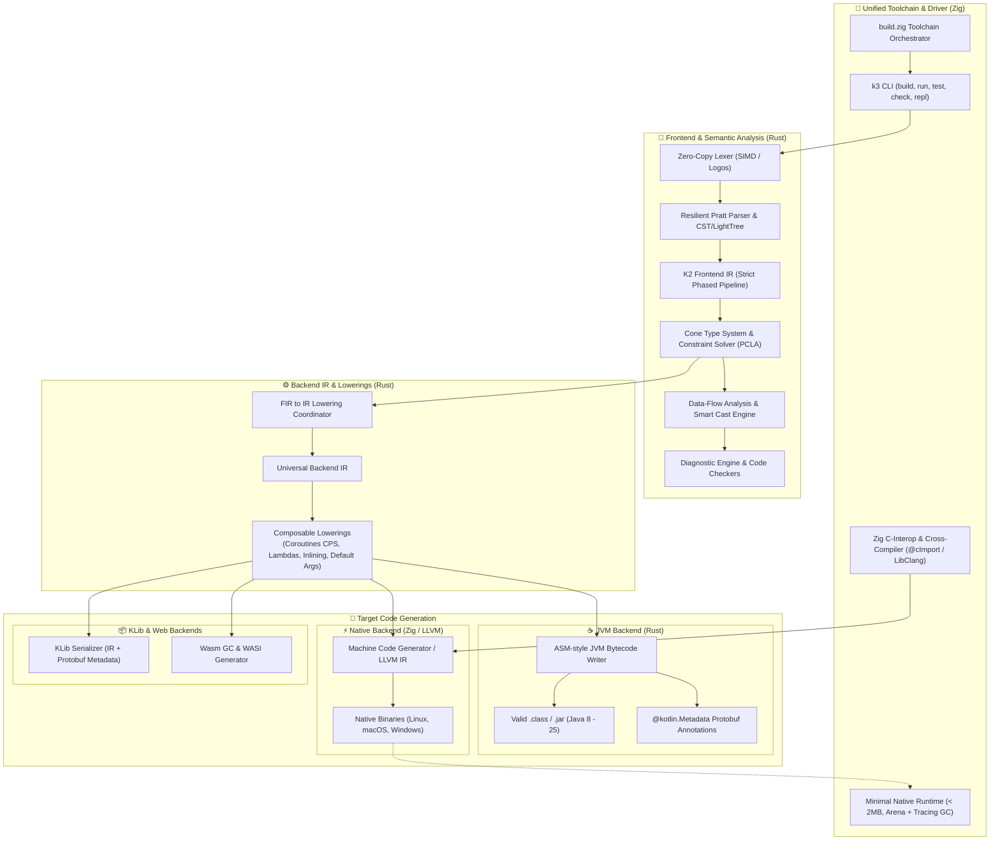
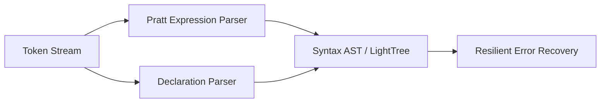
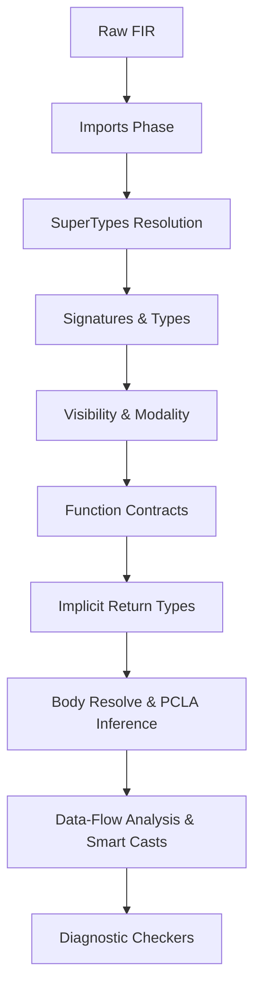
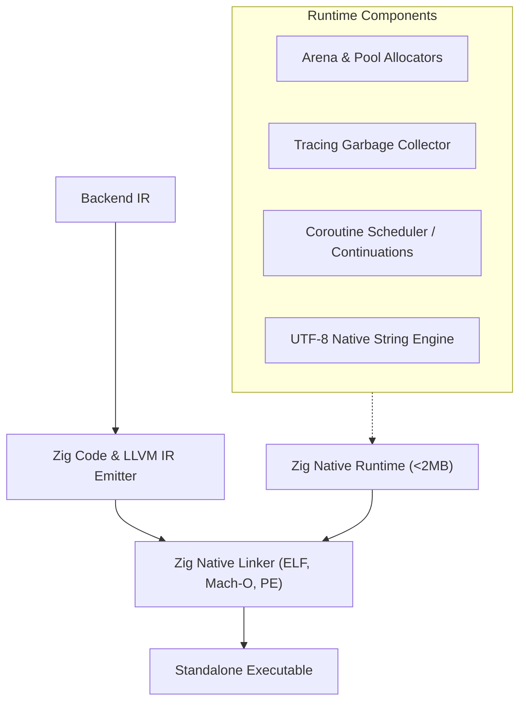

# 🗺️ Kotlin3 (k3) Project Roadmap

Welcome to the **Kotlin3** engineering roadmap! This document charts our journey toward creating an ultra-fast, independent Kotlin compiler and self-contained toolchain engineered in **Rust** and **Zig**, culminating in **Kotlin self-hosting**.

---

## 🎯 North Star Goals

- ⚡ **10x–50x Build Acceleration**: Sub-second cold compilation without JVM warmup, heavy memory allocations, or Gradle daemon overhead.
- 📦 **Zero-Dependency Self-Contained Toolchain**: Single unified executable (`k3`) handling compilation, execution, testing, dependency resolution, and cross-compilation.
- 🛡️ **100% Kotlin 2.x Compatibility**: Drop-in language conformance with Kotlin K2 specification, standard `.class` bytecodes, `@kotlin.Metadata`, and `.klib` packages.
- 🌐 **Native & Multiplatform First**: Zero-JVM native binaries via Zig's minimal runtime alongside standard JVM bytecode generation for Android and server backends.

---

## 🏛️ High-Level System Architecture

---

## 📅 Roadmap Overview & Progress Matrix

| Milestone | Phase Focus | Key Deliverables | Status | Target |
| :--- | :--- | :--- | :---: | :--- |
| **v0.1.0** | 🏗️ **Scaffolding & Core Foundations** | Multi-crate Rust workspace, SIMD Lexer, K2 FIR skeleton, Zig driver | 🟢 **Completed** | Q4 2026 |
| **v0.2.0** | 📜 **Syntax Parser & AST Construction** | Full Pratt Expression Parser, Declarations AST, LightTree parser | 🟢 **Completed** | Q4 2026 |
| **v0.3.0** | 🧠 **K2 FIR & Cone Type Resolution** | Phased symbol resolution, Cone types, Type inference (PCLA), DFA smart casts | 🟢 **Completed** | Q4 2026 |
| **v0.4.0** | ☕ **JVM Bytecode Generation** | Classfile binary emission, StackMapTable calculation, `@kotlin.Metadata` | 🟡 **In Progress** | Q1 2027 |
| **v0.4.0** | ☕ **JVM Bytecode Generation** | Classfile binary emission, StackMapTable calculation, `@kotlin.Metadata` | ⚪ Planned | Q3 2027 |
| **v0.5.0** | ⚙️ **Backend IR & Lowerings** | Coroutine state machines, lambda metafactories, default arguments | ⚪ Planned | Q4 2027 |
| **v0.6.0** | ⚡ **Zig Native Runtime & Code Gen** | Lightweight GC, arena memory manager, Native ELF/Mach-O/PE output | ⚪ Planned | Q1 2028 |
| **v0.7.0** | 📦 **KLib & Dependency Ecosystem** | Protobuf metadata reader/writer, `.klib` support, Maven Central JAR ingestion | ⚪ Planned | Q2 2028 |
| **v1.0.0** | 🏆 **Self-Hosting & Production Release** | Kotlin3 compiles itself, 100% JetBrains `testData` conformance passed | ⚪ Planned | Q3 2028 |

---

## 🔬 Detailed Phase Breakdown

### Phase 1: Foundations & High-Speed Lexing (v0.1.0) — *Current*
- [x] 🦀 Setup root Cargo workspace (`k3_syntax`, `k3_fir`, `k3_ir`, `k3_jvm`, `k3_cli`).
- [x] ⚡ Implement high-performance zero-copy Kotlin Lexer with Logos and SIMD tokenization.
- [x] 🧩 Define complete Kotlin 2.x token set (Hard keywords, Soft modifiers, Operators, Literals).
- [x] 📐 Build source span management (`Span`, byte offsets).
- [x] 🦎 Setup Zig master build coordinator (`build.zig`) and `runtime/src/main.zig` toolchain driver.
- [x] 🖥️ Build `k3` CLI with `lex` and `check` commands.
- [x] 🧪 Verify compilation and unit tests on WSL (Rust 1.100, Zig 0.17.1).

---

### Phase 2: Complete Kotlin Syntax Parser & CST (v0.2.0) — *Completed*

- [x] 📜 **Pratt Expression Parser**:
  - Full precedence climbing for Kotlin operator table (`+`, `-`, `*`, `/`, `%`, `==`, `===`, `?:`, `?.`, `as`, `is`, `in`, `..`, `..<`).
  - Safe call chains (`a?.b?.c()`), elvis expressions (`a ?: b`), and not-null assertions (`x!!`).
  - Lambda expressions, trailing lambdas (`items.map { it.name }`), and generic calls (`mutableListOf<T>()`).
- [x] 🏛️ **Declaration Parsers**:
  - Functions: `fun <T> List<T>.name(params): ReturnType { ... }` with extension receivers and type parameters.
  - Classes, interfaces, sealed hierarchies, data classes, inline/value classes.
  - Properties with initializers and type annotations (`val name: Type = expr`).
- [x] 🛡️ **Error-Tolerant AST**:
  - AST with accurate source `Span` tracking across all declaration and expression nodes.
  - Added `k3 parse <file.kt>` command to `k3_cli`.

---

### Phase 3: K2 FIR Phased Semantic Engine (v0.3.0) — *Completed*

- [x] 🌲 **Phased Resolution Invariants**:
  - Implemented top-level declaration indexing, header typing, local body resolution, and diagnostic reporting.
- [x] 🧬 **Cone Type System**:
  - `ConeClassLikeType`, `ConeTypeParameterType`, `ConeFlexibleType`, and `ConeIntersectionType` with full subtyping rules.
- [x] 🔍 **Symbol Table & Scopes**:
  - Delegating lexical, class member, file, and built-in root scopes (`k3_fir/src/symbols.rs`).
- [x] 🌊 **Data-Flow Analysis (DFA)**:
  - Smart-casting tracking across branching paths (`if` and `when`).
- [x] 🛡️ **Diagnostic Engine**:
  - Formatted terminal diagnostics with line/column/caret positioning and severity codes.

---

### Phase 4: JVM Bytecode & Binary Classfile Emitter (v0.4.0)
- [ ] ☕ **Classfile Generation**:
  - Emission of valid Java 8 through Java 25 `.class` files.
  - Automated constant pool deduplication and indexing.
  - `StackMapTable` frame calculation for Java 7+ strict verification.
- [ ] 🏷️ **`@kotlin.Metadata` Integration**:
  - Protobuf encoding of Kotlin declaration metadata embedded into classfile annotations.
  - Ensures existing tools (IntelliJ, Android Studio, D8/R8, ProGuard, ByteBuddy) recognize classes seamlessly.
- [ ] ⚡ **Bytecode Optimizations**:
  - `invokedynamic` for lambdas and Java 9+ `StringConcatFactory`.
  - Intrinsic function mappings (`kotlin.math`, primitives).

---

### Phase 5: Backend IR & Composable Lowerings (v0.5.0)
- [ ] 🔄 **Universal Backend IR**:
  - Single abstract tree representing executable logic decoupled from backend targets.
- [ ] ⚙️ **Core Lowering Transformations**:
  - **Coroutines Transformation**: CPS (Continuation-Passing Style) state machines for `suspend` functions.
  - **Default Parameter Stubs**: Synthetic bitmask flags and wrapper functions.
  - **Inline Functions & Reified Generics**: AST-level call-site inlining.
  - **Value Classes**: Complete unboxing to primitive representations.

---

### Phase 6: Zig Native Runtime & Multiplatform Codegen (v0.6.0)

- [ ] ⚡ **Minimal Native Runtime**:
  - Sub-millisecond startup, `< 2 MB` binary footprint.
  - Tracing concurrent garbage collector without heavy JVM stop-the-world pauses.
  - Lightweight fiber/continuation runtime for Kotlin coroutines.
- [ ] 🔗 **Direct C / C++ Interoperability**:
  - Native `@cImport` translation via Zig, removing the need for slow JNI wrappers.

---

### Phase 7: KLib Ecosystem & Self-Hosting (v0.7.0 – v1.0.0)
- [ ] 📦 **KLib Architecture**:
  - Read and write standard `.klib` packages compatible with JetBrains Kotlin.
  - Maven Central and Gradle dependency resolution for `.jar` and `.klib` libraries.
- [ ] 🔄 **Self-Hosting Milestone**:
  - Kotlin3 compiles its own standard library and Kotlin-written tooling modules.
  - Continuous validation against JetBrains official `compiler/testData/` conformance suite.

---

## 📊 Target Performance Benchmarks

| Metric | Official `kotlinc` (JVM + Gradle) | Kotlin3 Target (`k3`) | Projected Improvement |
| :--- | :--- | :--- | :---: |
| **Cold Startup Time** | ~1,200 ms - 2,500 ms | **< 15 ms** | **~100x faster** |
| **Small Project Build (10 files)** | ~3,500 ms (Gradle init + daemon) | **< 50 ms** | **~70x faster** |
| **Medium Project Build (500 files)** | ~12,000 ms | **< 400 ms** | **~30x faster** |
| **Peak Memory Consumption** | ~800 MB - 2.5 GB (JVM Heap) | **< 60 MB** | **~95% less RAM** |
| **Native Binary Output Size** | ~35 MB (Kotlin/Native) | **< 4 MB** | **~9x smaller** |

---

## 🤝 How to Contribute
See [CONTRIBUTING.md](file:////wsl.localhost/Ubuntu/home/xagi/Kotlin3/kotlin3/docs/contributing.md) for local development workflows, issue tracking, and testing guidelines.
