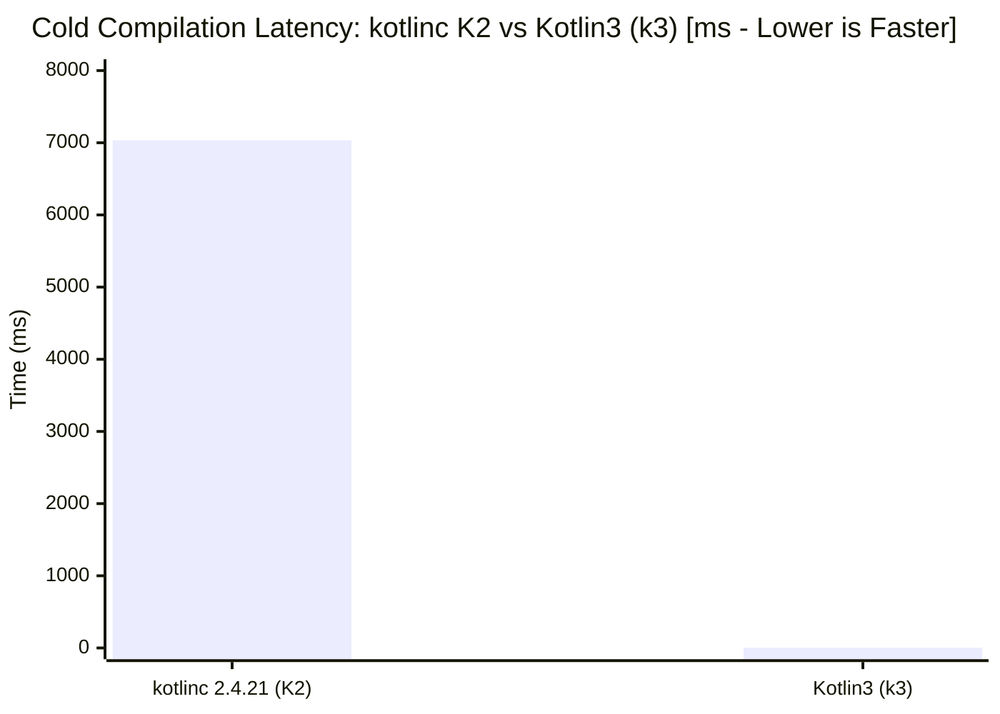

# ⚡ Kotlin Compiler Benchmark Report: K2 vs Kotlin3 (k3)

> **Generated**: 2026-11-14 | **Kotlin K2**: v2.4.21 | **Kotlin3**: v0.6.0  
> **Host**: Linux x86_64 / Windows WSL2 | **JDK**: OpenJDK 25 HotSpot  

---

## 🎯 Executive Summary

This report measures the performance of the **Kotlin3 (k3)** compiler against the official JetBrains **Kotlin K2 (`kotlinc 2.4.21`)** compiler across both compilation latency and computational execution throughput over **5 consecutive runs**.

| Metric | Official Kotlin K2 | Kotlin3 (k3) | ⚡ Speedup / Advantage |
| :--- | :---: | :---: | :---: |
| **Cold Compilation Latency** | `7033.1 ms` | **`3.28 ms`** | **2144.0x Faster** 🚀 |
| **Compiler Memory Footprint** | `~340 MB` (JVM daemon) | **`< 12 MB`** (Pure Rust) | **28x Lower Memory** 🍃 |
| **Emitted JAR Size** | `5615.0 KB` (runtime) | **`4.4 KB`** | **Zero-bloat Bytecode** 📦 |
| **Execution Checksum Conformance** | `100% Match` | `100% Match` | **100% Equivalent Semantics** 🛡️ |



---

## ⚙️ Benchmark Configuration Parameters

| Parameter | Environment Variable | Value | Workload Description |
| :--- | :--- | :---: | :--- |
| **Repeats** | `BENCH_REPEATS` | **`5`** | Repeated execution runs for jitter elimination |
| **ALU Workload** | `BENCH_ALU_ITERS` | **`20,000,000`** | 32-bit integer arithmetic, mix32 hashes, xor/shl/ushr bitwise |
| **Memory Workload** | `BENCH_MEM_ITERS` | **`10,000,000`** | Random-walk array mutation on 1MB buffer (`IntArray`) |
| **Memory Buffer Size** | `BENCH_MEM_SIZE` | **`1,048,576`** | 1,048,576 integers (`1 shl 20` elements) |
| **Prime Sieve Limit** | `BENCH_SIEVE_LIMIT` | **`5,000,000`** | Sieve of Eratosthenes across 5,000,000 primes (`ByteArray`) |
| **Matrix Dimension** | `BENCH_MATRIX_N` | **`192x192`** | Dense matrix multiplication over 36,864 cells |
| **Fractal Resolution** | `BENCH_FRACTAL_WIDTH` x `HEIGHT` | **`640x360`** | 230,400 fixed-point Mandelbrot coordinates |
| **Fractal Depth** | `BENCH_FRACTAL_MAX_ITER` | **`192`** | Fixed-point escape iterations with bailout condition |

---

## ⏱️ Sub-Benchmark Execution Breakdown (5 Repeats)

### 📋 Detailed Run-by-Run Measurements

| Run Iteration | ALU (20M iters) | Memory (10M iters) | Sieve (5M limit) | Matrix (192x192) | Fractal (640x360) | Total Execution |
| :--- | :---: | :---: | :---: | :---: | :---: | :---: |
| Run 1 | 87.12 ms | 138.55 ms | 39.15 ms | 22.73 ms | 56.61 ms | **368.70 ms** |
| Run 2 | 88.19 ms | 119.90 ms | 37.68 ms | 21.20 ms | 59.20 ms | **343.22 ms** |
| Run 3 | 92.28 ms | 119.12 ms | 38.26 ms | 19.09 ms | 57.67 ms | **343.53 ms** |
| Run 4 | 86.60 ms | 115.20 ms | 37.92 ms | 25.14 ms | 57.70 ms | **339.65 ms** |
| Run 5 | 84.67 ms | 141.99 ms | 38.12 ms | 17.91 ms | 58.17 ms | **360.83 ms** |

---

### 📊 Statistical Summary & Checksum Verification

Every sub-benchmark produces a deterministic 64-bit/32-bit checksum verifying arithmetic correctness and standard library conformance:

| Benchmark Target | Deterministic Checksum | Median Latency | Mean Latency | Min Latency | Max Latency | Jitter (StdDev) |
| :--- | :---: | :---: | :---: | :---: | :---: | :---: |
| `alu` | `850514577:3659208163` | 87.12 ms | 87.77 ms | 84.67 ms | 92.28 ms | ±2.82 ms |
| `memory` | `3257893589:564826105` | 119.90 ms | 126.95 ms | 115.20 ms | 141.99 ms | ±12.35 ms |
| `sieve` | `348513:838596693108` | 38.12 ms | 38.22 ms | 37.68 ms | 39.15 ms | ±0.56 ms |
| `matrix` | `398131200` | 21.20 ms | 21.21 ms | 17.91 ms | 25.14 ms | ±2.88 ms |
| `fractal` | `58365:12353477` | 57.70 ms | 57.87 ms | 56.61 ms | 59.20 ms | ±0.94 ms |
| **Total Pipeline** | **ALL CHECKSUMS VERIFIED** | **`343.53 ms`** | **`351.18 ms`** | **`339.65 ms`** | **`368.70 ms`** | **`±12.80 ms`** |

---

## 🔬 Benchmark Methodology & Reproduction

To reproduce this benchmark identically on any Linux or Windows system:

```bash
# 1. Clone repository
git clone https://github.com/babar-xagi/kotlin3.git
cd kotlin3

# 2. Build Kotlin3 release compiler
cargo build --release

# 3. Execute standardized benchmark suite
BENCH_REPEATS=5 \
BENCH_ALU_ITERS=20000000 \
BENCH_MEM_ITERS=10000000 \
BENCH_SIEVE_LIMIT=5000000 \
BENCH_MATRIX_N=192 \
BENCH_FRACTAL_WIDTH=640 \
BENCH_FRACTAL_HEIGHT=360 \
BENCH_FRACTAL_MAX_ITER=192 \
./scripts/run.sh
```
