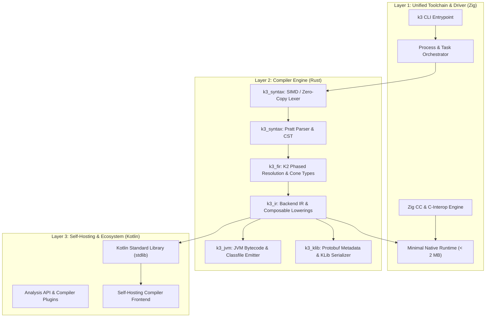

# 🏛️ Kotlin3 Architecture Specification

This document provides a comprehensive technical breakdown of **Kotlin3**, explaining how **Rust**, **Zig**, and **Kotlin** cooperate to deliver a high-speed, zero-dependency compiler and runtime.

---

## 1. System Topology

Kotlin3 is structured into three symbiotic layers:



---

## 2. Layer 1: Unified Toolchain & Driver (Zig)

### Why Zig for the Driver and Native Runtime?
1. **Instantaneous Startup**: Unlike JVM-based compilers or complex Python/Node wrappers, Zig binaries execute with `< 5ms` latency.
2. **Integrated Cross-Compilation**: Zig includes a built-in cross-compiling C/C++ toolchain (`zig cc`), native assemblers, and linkers for all major targets (x86_64, aarch64, Windows, macOS, Linux, WASI).
3. **Deterministic Memory Model**: The native runtime does not hide allocations. It utilizes arena allocators for compilation phases and an explicit tracing collector for user objects.

### Native Runtime Subsystems (`runtime/src/runtime/`):
- **Object Model**: Memory header layout compatible with 64-bit alignment:
  ```
  +------------------+------------------+------------------+
  | Type Info / Vtbl | GC Mark & Flags  | Payload Fields   |
  | (8 bytes)        | (8 bytes)        | (N bytes)        |
  +------------------+------------------+------------------+
  ```
- **Garbage Collector**: A lightweight non-moving concurrent/parallel mark-and-sweep collector with sub-millisecond pause times.
- **Coroutines & Continuations**: Stackless coroutine frames dispatched via lightweight state-machine handlers.

---

## 3. Layer 2: Compiler Engine (Rust)

### Why Rust for the Core Compiler?
1. **Algebraic Data Types & Pattern Matching**: Critical for representing AST, FIR, and IR nodes safely and concisely.
2. **Memory Safety without GC**: The compiler itself avoids garbage collection pauses; memory is managed via strict lifetimes and arena allocators (`bumpalo` or `typed-arena`).
3. **Data Parallelism (Rayon)**: Allows independent files and FIR phases to be resolved concurrently across all available CPU cores.

### Core Compiler Crates:

| Crate | Responsibility |
| :--- | :--- |
| **`k3_syntax`** | Zero-copy token scanning (`logos`), lossless syntax trees (preserving comments/trivia), Pratt expression parsing. |
| **`k3_fir`** | Kotlin 2.0 Frontend Intermediate Representation (FIR), Cone type hierarchy, phased declaration resolution, DFA smart casts. |
| **`k3_ir`** | Universal backend IR graph, lowered representation of language constructs (coroutines, default parameters, lambdas). |
| **`k3_jvm`** | Direct classfile binary emission (`.class`), constant pool deduplication, stack map table verification. |
| **`k3_klib`** | Reading and writing `.klib` archives (Protobuf metadata + serialized IR). |
| **`k3_cli`** | Standalone command-line interface. |

---

## 4. Layer 3: Kotlin Self-Hosting & Standard Library

- **Standard Library (`stdlib/`)**: Implemented in idiomatic Kotlin with native intrinsic hooks mapped to Zig runtime functions or JVM bytecode.
- **Analysis API Compatibility**: Provides structured semantic queries (`KaSession`, `KaSymbol`) so that IDE tooling (IntelliJ IDEA, Fleet, Zed, VS Code LSP) can interface with Kotlin3 effortlessly.
- **Self-Hosting Path**: Once the Kotlin3 compiler can parse, type-check, and compile the Kotlin language constructs used within its own source base, the compiler's frontend will be capable of self-compilation.
